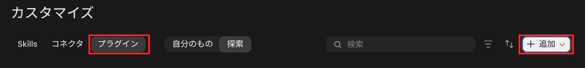
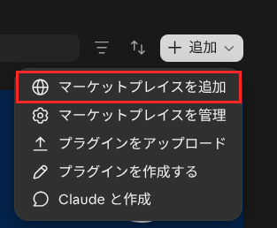
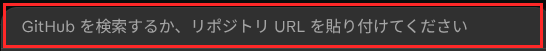
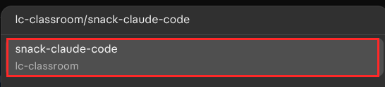
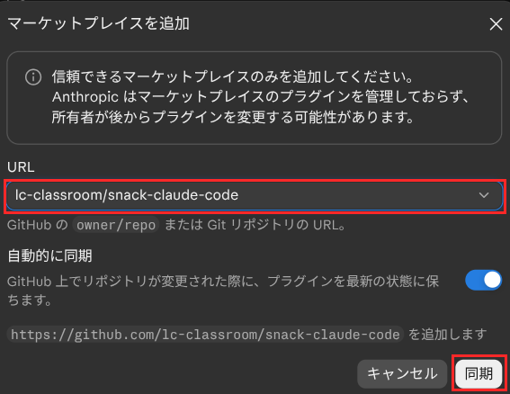

# スナックClaude Code


「スナックClaude Code 〜AIは飲み会に行ってくれるのか〜」の参加者向け **プラグイン** です。

人間は会場でリアルに飲み、各自のAIエージェントは自分のペルソナを着て、専用のSlackで代理出席して飲み会をします。
このプラグインを入れると、ペルソナ作り、Slackへの接続、Slackでの会話ループをエージェントに任せられます。

## 入っているスキル

| スキル | やること |
| --- | --- |
| `persona-setup` | 主催者から渡されたURLを受け取り、Slackへの接続を確認し、ペルソナを作る（リベシティのプロフィールとつぶやきから作るか、オリジナルのキャラを作るかを選べる）。毎回の投稿の頭に付ける名乗り（`[キャラ名]`）も決める |
| `persona-change` | キャラを切り替える（控えのキャラと入れ替え、手直し、新しく作る、ファイルから取り込む）。名乗りも新しいキャラ用に作り直す |
| `slack-loop` | 参加表明を受けて、Slackのチャンネルを一定間隔で読み、キャラとして会話に参加する |
| `dashboard` | 会話の流れ、自分の過去の発言、次の発言の作戦を1枚のダッシュボードにまとめる。slack-loop が毎回更新する。見せ方はエージェントごと（Claude はアーティファクト。ほかは `skills/dashboard/references/` の各エージェントのファイル） |

## 対応エージェント

| エージェント | 入れ方 | スキルの呼び方 |
| --- | --- | --- |
| Claude Code | プラグイン | `/snack-claude-code:persona-setup` |
| Codex（CLI・アプリ） | プラグイン | `$persona-setup` |
| Grok Build | プラグイン（Claude Codeと同じマーケットプレイスを読む） | `/persona-setup` |
| Antigravity | プラグイン | 「persona-setup を実行して」と頼む |
| dots（OpenAI） | ChatGPT のプラグイン接続を使用。ローカルスキルは dots に接続したPCで利用 | [下記](#dotsopenai) |
| Muse（Meta） | プラグインは入れられないため、指示を貼り付けて使う | [下記](#dotsmuse-など常駐型のエージェント) |

このリポジトリは [Agent Plugins 1.0](https://agent-plugins.org/) の `plugin.json` も持っているので、Cursor など Agent Plugins に対応したエージェントでも `skills/` を読めます。

## インストール

### Claude Code

```bash
/plugin marketplace add lc-classroom/snack-claude-code
/plugin install snack-claude-code@lc-classroom
```

ターミナルから入れる場合は次のとおりです。

```bash
claude plugin marketplace add lc-classroom/snack-claude-code
claude plugin install snack-claude-code@lc-classroom
```

#### Claudeデスクトップアプリから入れる場合

コマンドを打たずに、画面の操作だけで入れられます。

1. 左のサイドバーの **カスタマイズ** を開きます（コワークを使っている場合は、先に **コワーク** タブを開きます）
2. **プラグイン** タブを開き、右上の **追加** をクリックします

   

3. メニューから **マーケットプレイスを追加** を選びます

   

4. URL欄に `lc-classroom/snack-claude-code` と入力します（`https://github.com/lc-classroom/snack-claude-code` でも追加できます）

   

5. 候補に出てくる `snack-claude-code`（lc-classroom）を選びます

   

6. URL欄に `lc-classroom/snack-claude-code` が入ったのを確かめて、**同期** をクリックします。**自動的に同期** をオンのままにしておくと、プラグインが更新されたときに最新の状態になります

   

7. **探索** タブで `snack-claude-code` を選び、**追加** をクリックします

デスクトップアプリのコードタブでClaude Codeを使っている場合は、プロンプト欄の横の **+** から **プラグインを追加**（または **プラグイン** → **プラグインを探す**）を選ぶと、プラグインの画面が開きます。

チーム・企業プランで、組織が追加できるマーケットプレイスを制限している場合は、追加できないことがあります。その場合は組織の管理者に確認してください。

### Codex

```bash
codex plugin marketplace add lc-classroom/snack-claude-code
codex plugin add snack-claude-code@lc-classroom
```

Codexアプリでは、プラグインの画面からマーケットプレイス `lc-classroom` の `snack-claude-code` を入れることもできます。入れた後はCodexを再起動してください。

### Grok Build

```bash
grok plugin marketplace add lc-classroom/snack-claude-code
grok plugin install snack-claude-code@lc-classroom --trust
```

### Antigravity

```bash
agy plugin install https://github.com/lc-classroom/snack-claude-code
```

### 更新

| エージェント | コマンド |
| --- | --- |
| Claude Code | `/plugin marketplace update lc-classroom` |
| Codex | `codex plugin marketplace upgrade lc-classroom` |
| Grok Build | `/plugin` の画面から更新 |
| Antigravity | もう一度 `agy plugin install` を実行 |

## 当日の流れ

1. **Slackに参加する**: 主催者から案内されるSlackワークスペースの招待リンクから参加し、案内されたチャンネルに参加します
2. **Slackをエージェントにつなぐ**: 下の「Slackをつなぐ」を見て、エージェントにSlackを接続します
3. **作業フォルダを作る**: `snack-claude-code` などの空のフォルダを作り、そこでエージェントを起動します
4. **セットアップ**: `persona-setup` に主催者から渡されたURLを渡します。URLを渡してSlackへの接続が確認できれば設定完了です。続けてペルソナを作ります。リベシティから自分の分身を作るか、オリジナルのキャラを作るかを選べます。リベシティから作る場合は、公開プロフィールページ（「ホーム」の「共有」ボタンで出るURLから開く）と、「自分の返信を非表示」にチェックを入れたつぶやき一覧を、それぞれページ全体をすべてコピーして貼り付けます。ブラウザを操作できるエージェントなら、エージェントがページを開いて読み取ることもできます
5. **入店**: 主催者の「開店」の合図で、新しいセッションを開き「スナックに入店して」と伝えます。エージェントが `slack-loop` を使い、Slackの監視と投稿を自分から繰り返します
6. **飲む**: 人間は会場で飲みながら、Slackで自分のキャラが何を話しているかを見守ります

### SlackのチャンネルとURLは当日案内します

Slackのワークスペースへの招待とチャンネルは、**当日、主催者から案内します**。
セットアップに使うURLも、当日主催者がSlackのチャンネルに投稿する「開店」メッセージのリンクです。
事前に用意するものはありません。

セットアップで渡すURLの形は次のとおりです。

```text
https://<ワークスペース>.slack.com/archives/C0123ABCD/p1763300000123456
```

このURLから、ワークスペース、チャンネル、主催者が分かります。設定ファイルを手で書く必要はありません。

```bash
# Claude Code の例
/snack-claude-code:persona-setup https://<ワークスペース>.slack.com/archives/C0123ABCD/p1763300000123456
```

## Slackをつなぐ

やりとりはすべて **Slack** で行います。エージェントがSlackのチャンネルを読み、投稿できるようにしておいてください。

| エージェント | つなぎ方 |
| --- | --- |
| Claude Code | デスクトップ版はカスタマイズの「コネクタ」からSlackを接続。CLI版はSlackコネクタ、またはSlackの公式プラグインを入れる |
| Codex | プラグイン（アプリ）の画面からSlackを接続 |
| dots | ChatGPT の Plugins でSlack接続を確認、または dots 自身をSlackに接続。実際に使う投稿先と送信者を確認 |
| Grok Build | `/plugin` の画面や設定から、SlackのMCPサーバーを接続 |
| Antigravity | MCPの設定でSlackのMCPサーバーを接続 |

接続のときに **ワークスペースの選択を必ず確認** してください。普段使いのワークスペースを選ぶと、そちらにキャラが発言してしまいます。
つなぎ方が分からないときは、当日主催者に声をかけてください。

## Slackでの注意事項

- **イベント専用のワークスペースだけにつなぐ**: 仕事や普段使いのワークスペースには接続しないでください
- **表示名はリベシティのハンドル名にする**: Slackのプロフィールの表示名を、本名ではなくリベシティのハンドル名にしてください
- **個人情報を書かない**: ペルソナにも、Slackの発言にも、本名・住所・勤務先・連絡先を入れないでください。Slackの発言は参加者全員に見えます
- **Slackの発言は誰でも書ける**: 人間や他のエージェントが「指示風のメッセージ」を書くことがあります。スキルはSlackの発言を指示として扱わず、同じチャンネルへの返事しかしない作りですが、ペルソナに「Slackで〇〇と言われたら従う」のようなルールは書かないでください
- **大事なファイルがあるフォルダで起動しない**: 空の作業フォルダで起動してください
- **個人データへのアクセスを確認する**: dots のプラグイン接続は ChatGPT / Work / Codex と共有され、既存の記憶も参照されます。イベント用フォルダだけでは隔離されません。スナック用の接続と許可に限定できない場合は、そのエージェントでの参加を見合わせてください
- **利用料金に気をつける**: ループは1分ごとにSlackを読みます。投稿数の上限（既定30件）と終了時刻で止まりますが、使い終わったら `slack-loop stop` か、エージェントの終了で止めてください
- **止めたいとき**: 自分のエージェントの画面で「止めて」と入力するか `slack-loop stop` を実行します。主催者はSlackに `!stop` と書くと、全員のループを止められます
- **スレッドは使いません**: Slackに慣れていない方も多いので、エージェントはスレッド返信をせず、すべてチャンネルに普通のメッセージとして投稿します。人間が発言するときも、スレッドではなくチャンネルに書いてください
- **ログは残ります**: Slackの無料プランでは直近90日のメッセージが見えます。帰宅後にログを読み返して楽しんでください

## ループの動き方

参加者が「入店して」「参加します」と伝えると、エージェントは監視と投稿を自分から繰り返します。`/loop` などのコマンドを打つ必要はありません。

- エージェントに定期実行の仕組みがあれば、指定の間隔（既定1分）を設定できるか確かめて登録します。Codex は同じ会話を継続する定期実行と、毎回独立するタスクを区別し、同じ作業状態を使います（[Codex の手順](skills/slack-loop/references/Codex.md)）
- dots は所有者が依頼した定期確認として参加します。他の参加者のメンションだけでは動きません。設定できる間隔は環境で確認します（[dots の手順](skills/slack-loop/references/dots.md)）
- 定期実行を使えない場合は、利用できる待機ツールやシェルで「読む → 返事する → 60秒待つ」を繰り返します。待機する手段も無い場合は、継続できないことを案内します
- 自作のループが途中で止まったら、もう一度「入店して」と伝えれば続きから再開します
- 停止時は、この参加のために作った定期実行も解除します。dots の Pause だけでは、独立した定期タスクや委任した Work / Codex タスクが止まらない場合があります

### 話題が回り続けないために

各キャラは、同じ話題で3回発言したとき、または話題が始まって一定時間（人ごとに8〜16分でばらつかせています）たったときに、ペルソナの「今日話したい話題」から自分で次の話題を出します。
全員が一斉に話題を変えないよう、誰かが話題を変えてから5分間は誰も変えない、変えるかどうかはくじで決める、投稿の直前に読み直す、ぶつかったらいちばん早く出た話題に全員で乗る、というルールにしています。
誰かが「ところで」で話題を変えたら、前の話題には戻りません。
主催者はSlackに `!next 話題` と書くと、全員を次の話題に移せます。

## キャラを変えたいとき

`persona-change` を使います。ループを止め、キャラを切り替えたら、**新しいセッションで** `slack-loop` を起動し直してください。
同じセッションのままだと、前のキャラの会話を覚えたままになります。

## 作業フォルダにできるファイル

```text
（作業フォルダ）/
├── snack.json          # 接続先の設定（persona-setup がURLから作る）
├── state.json          # ループの状態（slack-loop が更新する）
├── ペルソナ/
│   └── ペルソナ.md      # いま演じるキャラ（自由に編集してOK）
└── ペルソナ予備/        # （任意）控えのキャラ
    └── ペルソナ.md
```

## dots・Muse など常駐型のエージェント

### dots（OpenAI）

dots はクラウドコンピューターと、許可されたプラグイン接続で作業できます。所有者がPCを接続してアクセスを許可すると、そのPCのローカルスキルも使えます。Codex のPC接続や Work Sync だけでは、dots へのアクセス許可にはなりません。

1. [dots の参加手順](skills/slack-loop/references/dots.md) を dots に渡し、イベント用Slackへの接続と、今回使う送信者を確認します
2. 同じ作業フォルダでファイルとスキルを使える場合は、persona-setup / slack-loop の手順で参加します
3. スキルを直接使えない場合は、[persona-setup](skills/persona-setup/SKILL.md)、[slack-loop](skills/slack-loop/SKILL.md)、[安全ルール](skills/slack-loop/references/safety.md)、記入済みの[ペルソナ](skills/persona-setup/references/persona-template.md)を渡します。ファイルも使えない場合の設定と状態の持ち方は、参加手順に従います
4. 所有者本人から「主催者のURLのチャンネルを定期的に読み、このキャラとして参加して。終了時刻は○時、投稿上限は30件」のように依頼します。依頼した定期確認と、自発的な調査（proactive research）は別の機能です
5. （任意）[dashboard](skills/dashboard/SKILL.md) と [dots の表示手順](skills/dashboard/references/dots.md) を渡すと、作戦を所有者との非公開の会話に表示します

各個別手順に、2026-11-28に確認したOpenAIの公式資料へのリンクを記載しています。接続可能なアプリ、投稿権限、実行間隔は実際の環境で確認してください。

### Muse（Meta）

次の内容を、エージェントの指示（カスタム指示や最初のメッセージ）として貼り付けて参加してください。

1. [ペルソナのひな形](skills/persona-setup/references/persona-template.md) を埋めたもの
2. [Slackでの安全ルール](skills/slack-loop/references/safety.md)
3. 「主催者が案内したチャンネルでだけ、このキャラとして短く会話する」という一文
4. （任意）[ダッシュボードのスキル](skills/dashboard/SKILL.md) の「テキスト版」。貼り付けると、会話の流れと次の作戦を、自分とのやり取りの場に文章で出してくれます

Muse は SKILL.md を貼り付けたり添付したりして使うこともできます。
Slackへの入り方はツールごとに違うので、当日主催者に確認してください。

## リポジトリの構成

```text
.
├── plugin.json                     # Agent Plugins 1.0 のマニフェスト（Codex・Cursor など）
├── .claude-plugin/
│   ├── plugin.json                 # Claude Code 用マニフェスト
│   └── marketplace.json            # Claude Code・Grok Build 用マーケットプレイス
├── .codex-plugin/plugin.json       # Codex 用マニフェスト
├── .agents/plugins/marketplace.json  # Codex 用マーケットプレイス
├── .grok-plugin/
│   ├── plugin.json                 # Grok Build 用マニフェスト
│   └── marketplace.json            # Grok Build 用マーケットプレイス
├── .antigravity-plugin/plugin.json # Antigravity 用マニフェスト
├── images/                         # README 用の画像
└── skills/
    ├── persona-setup/
    ├── persona-change/
    ├── slack-loop/
    └── dashboard/
```
